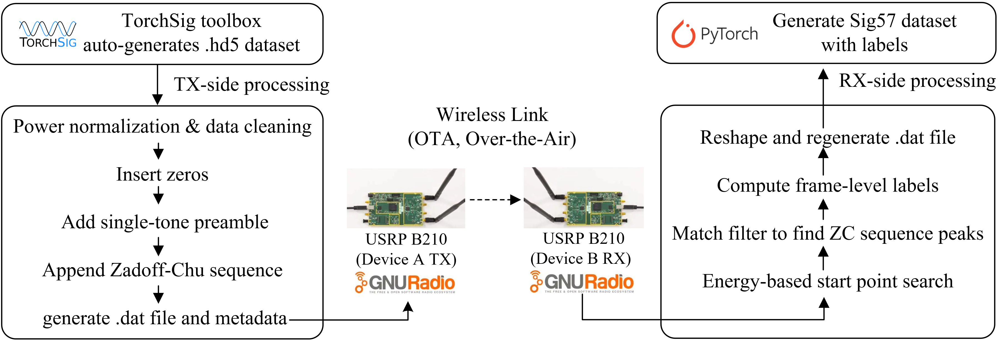
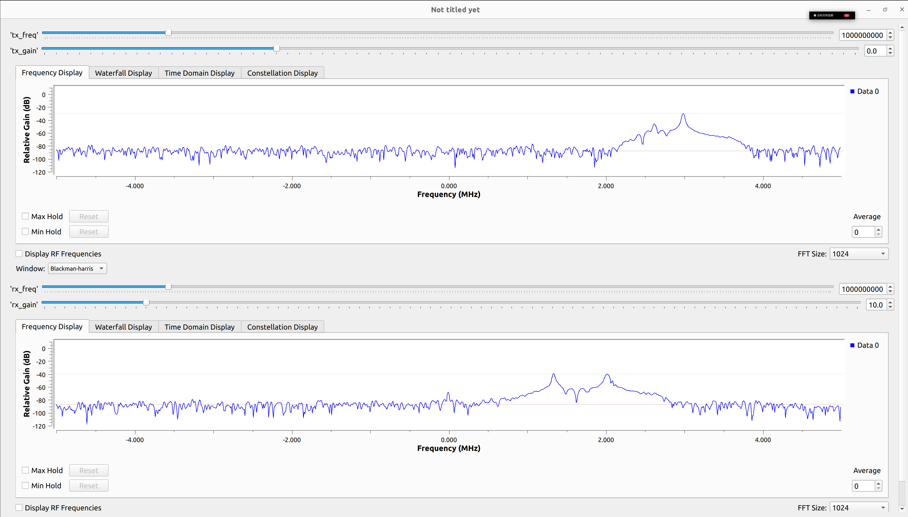

# Sig57 Dataset Preparation and OTA Acquisition

This repository contains code, example data, and diagrams for preparing Sig57 signals and collecting over-the-air (OTA) measurements for automatic modulation recognition research. The workflow combines TorchSig-based waveform generation, transmitter frame preparation, GNU Radio/USRP acquisition, and MATLAB receiver processing.

## Acquisition workflow



Synthetic I/Q waveforms are prepared for transmission with synchronization sequences and accompanying metadata. After OTA transmission and recording, the MATLAB receiver scripts use energy detection, Zadoff–Chu preamble matching, frame alignment, and normalization to extract labeled signal frames.



## Repository contents

| Path | Description |
| --- | --- |
| `Torchsig_Tools/` | Bundled TorchSig source and Python scripts for waveform generation and data inspection. |
| `sig57_ota_matlab/` | MATLAB scripts for transmitter preparation and receiver-side signal extraction. |
| `scripts/subset_sig57.py` | Creates a reproducible, balanced subset of an existing HDF5 dataset. |
| `data_example_sig57_pretrain_1024LEN_50NUM_20to50SNRS_SP2_LBL/` | Synthetic example data, SNR-based shards, and sampling provenance. |

## Example data

The included example is a **synthetic subset before OTA transmission**, rather than a release of the complete OTA measurements. It contains 57 signal classes, with 50 frames per class at each of 15 SNR levels from 20 to 48 dB in 2 dB steps: 42,750 frames in total. Each frame contains 1,024 complex I/Q samples.

The HDF5 fields are `X` (I/Q samples, shape `(N, 2, 1024)`), `Y` (zero-based class labels), `Z` (SNR in dB), `BW` (bandwidth in Hz), and `FC` (center frequency in Hz). The subset also includes `source_indices` for tracing samples to the source file. Class names and their order are stored in the `modulation_types` attribute.

```python
from pathlib import Path
import h5py

data_dir = Path("data_example_sig57_pretrain_1024LEN_50NUM_20to50SNRS_SP2_LBL")
with h5py.File(data_dir / "github_shards/sig57_snr_20dB.h5", "r") as f:
    iq = f["X"][0]
    label = int(f["Y"][0])
    print(iq.shape, f.attrs["modulation_types"][label], float(f["Z"][0]))
```

Reading the example data requires `h5py` and `numpy`; TorchSig and radio hardware are not required. The merged HDF5 file and the SNR shards contain the same samples and should not be combined as separate datasets. See the example directory's README and `manifest.json` for sampling details and checksums.

## Using the acquisition scripts

Waveform generation requires the dependencies documented in `Torchsig_Tools/`. OTA acquisition additionally requires a compatible GNU Radio/USRP setup and MATLAB for the provided processing scripts. Update local paths and radio settings for your equipment before running the workflow. Keep the transmitter metadata paired with its corresponding receiver recording.

Generation scripts contain configurable settings that may differ from the included example data. Use the HDF5 attributes and manifest to identify the example's actual configuration; the directory name `20to50` does not imply that 50 dB samples are included.

## Acknowledgment

Waveform generation builds on [TorchSig](https://github.com/TorchDSP/torchsig). The bundled TorchSig source retains its upstream license and notices; see `Torchsig_Tools/LICENSE.md`.
